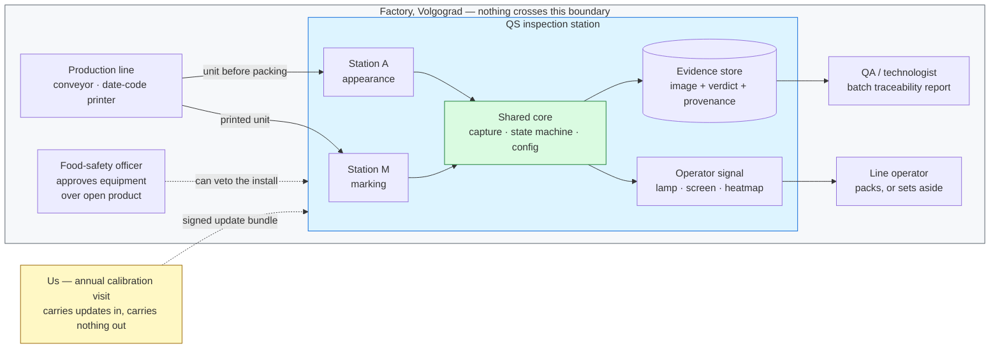
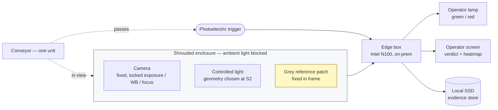
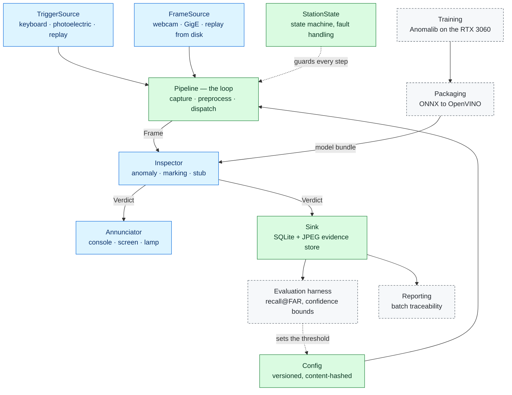
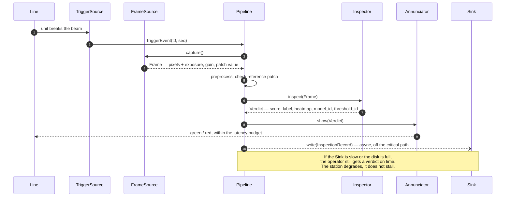
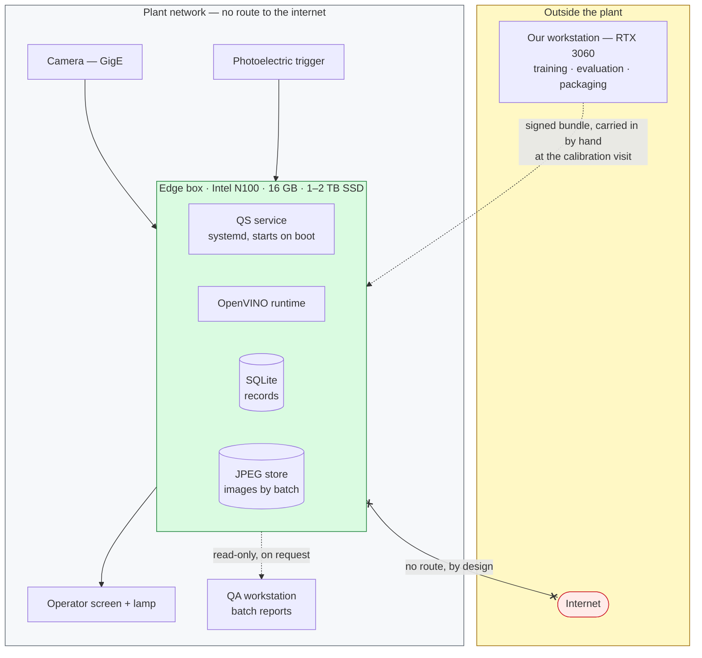

# System architecture

**Audience:** engineering. English, per the language policy.
**Status:** design. No code depends on this yet; `src/` implements it from E0.8 onward.
**Companions:** [`11-interfaces.md`](11-interfaces.md) (the contracts) ·
[`12-data-model.md`](12-data-model.md) (what is stored) ·
[`14-eval-protocol.md`](14-eval-protocol.md) (how it is measured) ·
[`16-failure-model.md`](16-failure-model.md) (how it breaks)

---

## 1. The one idea

There is **one program**. It runs at two places in the factory, with a different
inspector plugged in and a different config file loaded.

|  | Station M — marking | Station A — appearance |
|---|---|---|
| Where | the marking conveyor | the packing line, before the packing zone |
| What it decides | is the date code present, legible, correctly placed and correct? | does this unit look like the good units we were trained on? |
| Method | deterministic computer vision | anomaly detection (PatchCore / PaDiM / FastFlow) |
| Training data | none | hundreds of good units from *their* line |
| Time to working | weeks | months, gated on data |
| Reusable at customer #2 | identical | retrained per line |

Everything else — trigger, capture, evidence store, operator signal, config,
reporting, the state machine, the evaluation harness — is written once and shared.

This resolves an apparent contradiction in the older documents. `CLAUDE.md` §7 says
the marking station is *built first*; `04-build-plan.md` spends six stages building
the *appearance* demo. Both are right, because they are answering different questions:

- **What ships first** is Station M. Deterministic, no training data, and a batch has
  already been returned over marking.
- **What gets prototyped first** is Station A's detection method, on supermarket food,
  because it is the only thing that can start today and it answers the project's central
  technical question without the factory.

They are not competing. The prototype work and the shipping work run on the same core.

## 2. Context — who touches this

Three things this diagram is making a claim about:

- **The boundary is real.** No image, no verdict, no model leaves the building. This is
  152-ФЗ hygiene and trade-secret protection at the same time, and it closes the security
  objection before the client raises it.
- **The food-safety officer is drawn as an actor, not a footnote.** That person can stop
  the installation after the hardware is bought. They have not been asked anything yet
  (`OQ-6`).
- **The calibration visit is part of the architecture**, not an afterthought. It is the
  recurring-revenue line the client already agreed to, and it is also the only supported
  path for a model or config update.

## 3. Physical layout at the station

The **grey reference patch** is the cheapest good idea in this design. A fixed grey and
white target sits permanently inside the field of view, outside the product area. Its
measured value is recorded with every single frame. If it drifts, one of three things is
true: the lamp is ageing, ambient light is leaking past the shroud, or someone unlocked
the camera's automatic exposure. All three silently destroy a model that tested fine, and
all three are otherwise invisible until the false-alarm rate climbs weeks later.

It costs a piece of card. It gives us an automatic daily health check, a defensible reason
for the annual calibration visit, and — during the bench work at S2 — a way to prove that
two shooting sessions a week apart are actually comparable.

## 4. Components

This is the flow of data, not the call graph — the Pipeline orchestrates every step.
**Blue is swapped by config. Green is written once. Grey dashed never touches the
critical path.**

Blue is what changes between the cardboard-box demo and the factory. Green is what does
not. The claim in `04-build-plan.md` that "about 60% of the work is written once and never
touched again" is only true if blue really is one file per implementation behind a fixed
interface — which is what [`11-interfaces.md`](11-interfaces.md) pins down and what the
tests at E0.8 enforce.

Note the loop closing on the left: the evidence store feeds the evaluation harness, which
sets the threshold, which is part of the config that the running station loads. That is
the annual calibration visit drawn as a data path rather than a line item on an invoice.

**The replay source is the load-bearing one.** A `FrameSource` that reads images from
disk, in order, with their recorded metadata, means the entire pipeline can be run
offline, deterministically, against a frozen set of images. Every quality claim we make
becomes a command someone else can run. Without it, "we measured 92% recall" is a memory
of a good afternoon.

## 5. One unit, end to end

### Latency budget

The client's stated ceiling is one unit per second. The budget below is what Gate B
measures, on CPU as the Intel N100 proxy — **not** on the RTX 3060, where everything
looks fast and nothing is learned.

| Step | Budget | Note |
|---|---:|---|
| Trigger to shutter | 30 ms | hardware trigger; free at a static station |
| Capture and transfer | 80 ms | GigE frame off the wire |
| Preprocess | 40 ms | resize, normalise, reference-patch read |
| **Inference** | **400 ms** | the only number in real doubt — PatchCore does nearest-neighbour search against a memory bank |
| Threshold and verdict | 5 ms | |
| Annunciate | 50 ms | |
| **Total** | **605 ms** | **95 ms headroom against the 700 ms gate** |
| Persist | *async* | ≤2 s, off the critical path, never blocks a verdict |

If inference will not fit, the answers are in order: a smaller PatchCore coreset, a lower
input resolution, then PaDiM or FastFlow. That ordering matters — coreset size costs the
least accuracy per millisecond bought. This gets settled at S3, not at deployment.

## 6. Deployment

Sizing, carried over from `02-hardware.md` and unchanged: ~500 KB per image, ~5,000 units
per shift is ~2.5 GB per shift, roughly 75 GB per month. A 1–2 TB SSD holds about a year
of full traceability. The archive is part of what is being sold, not a by-product.

## 7. Invariants

These hold regardless of what any survey answer turns out to say. Each one is either a
legal constraint, a safety constraint, or a lesson already paid for.

| | Invariant | Why |
|---|---|---|
| I1 | **On-prem. No image leaves the building.** | 152-ФЗ, trade secret, and it closes the security objection before it opens |
| I2 | **Every unit inspected writes an immutable record** with its image, verdict and full provenance | ХАССП traceability has value on its own, and it is the training data for every future retrain |
| I3 | **Advisory only.** Operator alert, never automatic rejection | No PLC, no actuator, no line-safety sign-off. Prove detection before touching their machinery |
| I4 | **Hardware trigger, one image per unit.** Never free-running video | Free-running gives doubles, partials and misses |
| I5 | **Ambient light is blocked and lighting drift is measured** | Shift changes and daylight silently degrade models that tested fine (§3) |
| I6 | **Fail to "no verdict", never to "pass"** | Over open food, a silent false pass is the one unacceptable failure. See [`16-failure-model.md`](16-failure-model.md) |
| I7 | **A camera sees surfaces only** | No claim about the inside of opaque product, ever. Metal detection and X-ray exist for that reason |
| I8 | **Nothing is built on hardware that cannot be re-ordered** | Rules out Jetson, Basler, IDS — parallel import only. Hikrobot and Intel are the sourceable choices |
| I9 | **Persistence never blocks a verdict** | A full disk must degrade the station, not stop the line |

## 8. What this architecture deliberately does not have

No Docker. No web framework. No REST API. No user accounts. No cloud. No message broker.
No PLC integration. No rejection actuator.

Every one of those is a reasonable thing to want later and a certain way to not have a
demo in October. They are listed here so that adding one is a visible decision with an
ADR behind it, rather than an afternoon that quietly happened.
