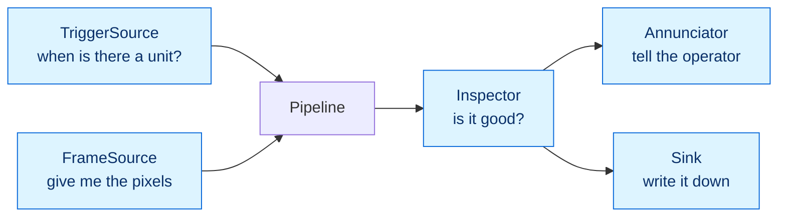

# Interface contracts

**Audience:** engineering. English, per the language policy.
**Status:** design, revised 2026-09-21 (design Step 4): per-check verdicts (ADR-0008), capture
that never returns a pre-trigger frame, and a polled trigger fed by the screen (ADR-0011).
`src/qs/contracts.py` implements this verbatim at E0.8.
**Why this document exists:** `04-build-plan.md` claims that going from cookies to the
client's product "means changing the training images and swapping the camera — it does
not mean rewriting the program," and that about 60% of the work is written once. That
claim is either load-bearing or wishful, and the difference is whether the seams are
written down before the code is. This is the seams.

---

## 1. Five contracts



Everything else in the system is a detail behind one of these five. The Pipeline knows
only the contracts; it never learns whether the camera is a webcam or a Hikrobot, whether
the inspector is a neural network or twelve lines of thresholding, or whether the trigger
is a photoelectric sensor or the spacebar.

## 2. The values that move between them

Six immutable records. Immutable because the same `Frame` is handed to the inspector, the
sink and — during evaluation — to several inspectors in a row, and a mutable frame makes
every one of those a possible source of a bug you cannot reproduce.

```python
class Label(StrEnum):
    PASS       = "pass"        # every check ran and passed
    DEFECT     = "defect"      # at least one check failed
    NO_VERDICT = "no_verdict"  # we could not decide; never means "pass"


@dataclass(frozen=True, slots=True)
class TriggerEvent:
    seq: int              # monotonic within a run, gapless — a gap means a missed unit
    t0: float             # perf_counter at the moment of the trigger; the latency clock
    wall: datetime        # UTC, for the record
    source_id: str        # "keyboard" | "photoelectric" | "replay:<dataset>"


@dataclass(frozen=True, slots=True)
class CameraReadback:
    exposure_us: int | None       # what the camera reports it is set to, not what we asked
    gain_db: float | None
    wb_kelvin: int | None
    focus: int | None
    verified: bool                # False if any value could not be read back (FR-13)


@dataclass(frozen=True, slots=True)
class Frame:
    event: TriggerEvent
    pixels: np.ndarray            # HxWx3, uint8, BGR — OpenCV's convention, kept throughout
    grabbed_at: float             # perf_counter when the camera delivered it; always > event.t0
    camera: CameraReadback
    reference_patch: float | None # mean luminance of the fixed grey target. See §5
    capture_ms: float             # trigger to pixels in hand


@dataclass(frozen=True, slots=True)
class CheckResult:
    name: str                     # "geometry" | "appearance" — later "marking"
    passed: bool
    value: float | None           # the number compared with the limit: the anomaly score
    limit: float | None           # the threshold applied
    measures: tuple[tuple[str, float], ...] = ()  # geometry: area_px, diameter_px, roundness
    failed_on: str | None = None  # e.g. "diameter_px<min", "score>threshold"


@dataclass(frozen=True, slots=True)
class Verdict:
    label: Label
    checks: tuple[CheckResult, ...]   # every check that ran; empty only for NO_VERDICT
    heatmap: np.ndarray | None        # HxW float32 in 0..1, frame coordinates, or None
    unit_box: tuple[int, int, int, int] | None  # x, y, w, h of the unit found
    model_id: str                 # name + version + weights hash
    threshold_id: str             # the calibration: the threshold AND the geometry tolerances
    config_hash: str              # the station config that produced it
    inspect_ms: float
    reason: str | None = None     # required when label is NO_VERDICT
```

**Why a tuple of checks, not one score.** Station A now decides with two checks (ADR-0008), and
Station M will add its own. The alternative — one typed field per check (`geometry: …`,
`appearance: …`) — reads better for two and grows the `Verdict` every time a station adds one.
A tuple of `CheckResult` keeps the `Verdict` fixed, and lets the Sink, the screen and the
evaluation harness treat every check the same way.

**`threshold_id` names the whole calibration.** The appearance threshold and the geometry
tolerances are derived in one step from the same good units (FR-54), so they version together.

`InspectionRecord` — what actually gets persisted — is in
[`12-data-model.md`](12-data-model.md), because its shape is driven by traceability
requirements rather than by the runtime.

## 3. The contracts themselves

```python
class TriggerSource(Protocol):
    """Polled once per main-loop tick; never blocks. Returns at most one event per unit and
    never skips one silently: if a unit is missed, seq still increments and the gap is recorded."""

    def poll(self) -> TriggerEvent | None: ...
    @property
    def exhausted(self) -> bool: ...   # True once a replay has no images left; live sources never
    def close(self) -> None: ...


class FrameSource(Protocol):
    """Turns an event into pixels. capture() returns the first frame the camera delivered
    AFTER event.t0, or raises CaptureError on timeout — never a buffered frame from before the
    trigger. preview() feeds the live view only; a preview frame is never inspected."""

    def open(self) -> None: ...
    def capture(self, event: TriggerEvent) -> Frame: ...
    def preview(self) -> np.ndarray | None: ...
    def health(self) -> Health: ...
    def close(self) -> None: ...


    """Decides. Must be deterministic given (frame, model, threshold): the same frame
    inspected twice returns the same score, or the evaluation harness is measuring noise.

    Must not do I/O. Must not mutate the frame. Must not read the clock for anything
    other than its own timing. Owns no state that changes between frames."""

    def load(self, config: StationConfig) -> None: ...
    def inspect(self, frame: Frame) -> Verdict: ...
    @property
    def model_id(self) -> str: ...


class Annunciator(Protocol):
    """Tells the operator. Must render NO_VERDICT visibly differently from PASS —
    see invariant I6. Must return within its slice of the latency budget."""

    def show(self, frame: Frame, verdict: Verdict) -> None: ...
    def close(self) -> None: ...


class Sink(Protocol):
    """Writes the record. MUST NOT raise into the Pipeline and MUST NOT block it:
    implementations queue and drain on a worker thread. A failing Sink degrades the
    station (see 16-failure-model.md); it never stalls the line and never loses a
    verdict the operator already acted on."""

    def write(self, record: InspectionRecord) -> None: ...
    def pending(self) -> int: ...
    def close(self) -> None: ...
```

### Why the trigger is polled

An iterator suits replay and nothing else. On the bench the key press arrives through the
screen's event loop (ADR-0011); at the factory the photoelectric line is a pin read on each tick.
`poll()` fits all three, and the main loop stays the one place where time passes:

```text
while not trigger.exhausted:
    if screen: screen.tick(frames.preview())   # draw the live view, read the keyboard
    event = trigger.poll()
    if event: pipeline.handle(event)            # capture → lighting → inspect → show → sink
```

`Screen` is not a contract. It is the one object that owns the OpenCV window; `KeyboardTrigger`
and `ScreenAnnunciator` are both constructed with it. Replay runs with no screen, as fast as the
disk allows.

### The rules that are not in the type signatures

| | Rule | What breaks without it |
|---|---|---|
| C1 | `Inspector.inspect` is deterministic given frame, model and threshold | The evaluation harness measures noise, and a gate number cannot be reproduced |
| C2 | `Inspector` performs no I/O and holds no per-frame state | Latency becomes unpredictable; replay stops matching live |
| C3 | `Sink.write` never raises and never blocks | A full disk stops the line, which is the failure the client will never forgive |
| C4 | `FrameSource.capture` returns only a frame delivered after `event.t0`, and raises rather than return a stale or partial one | A silent stale frame passes the previous unit's verdict onto this one |
| C5 | `TriggerEvent.seq` is gapless within a run | Missed units become invisible, and the count on the report stops matching the count on the line |
| C6 | Every implementation is constructed from `StationConfig` alone | "It worked on my machine" — configuration drifts into code |
| C7 | `Label.NO_VERDICT` is never rendered or recorded as a pass | Invariant I6. This is the one that matters over open food |
| C8 | `Verdict.label` is derived from `checks` alone: DEFECT if any failed; PASS only if at least one ran and all passed; otherwise NO_VERDICT with a reason | A PASS with no check behind it is a silent pass |
| C9 | A `preview()` frame is never inspected or recorded | Its moment is unknown; inspecting it breaks C4 |

## 4. Implementations

One file each. This table is the actual content of the claim that the demo and the factory
system are the same program.

| Contract | Bench demo (S4) | Factory (S6+) | Tests and evaluation |
|---|---|---|---|
| `TriggerSource` | `KeyboardTrigger` — spacebar, read through the Screen | `PhotoelectricTrigger` — GPIO / camera line in | `ReplayTrigger` — one event per image on disk |
| `FrameSource` | `WebcamSource` — V4L2, grab thread (ADR-0010) · `PhoneSnapshotSource` — fallback | `GigEVisionSource` — Hikrobot SDK | `ReplaySource` — reads images and their recorded metadata |
| `Inspector` | `AppearanceInspector` — localize, geometry, PatchCore on PyTorch (ADR-0008, 0009) | same, OpenVINO backend · `MarkingInspector` — deterministic | `StubInspector` — scripted checks, no model |
| `Annunciator` | `ScreenAnnunciator` — verdict, heatmap, session panel, via the Screen (ADR-0011) | same, plus `LampAnnunciator` | `NullAnnunciator` — records calls |
| `Sink` | `SqliteSink` + JPEG store | same, plus batch ID | `SqliteSink` on a temp directory |

Two things follow from reading the table across:

**The `Sink` column never changes.** Nor does the Pipeline, the state machine, the config
loader, the evidence schema or the evaluation harness. That is where the 60% lives, and it
is why the marking station shipping first is not time spent away from the appearance
station — it builds and hardens the same core.

**`ReplaySource` is not a test double.** It is a first-class implementation used to
produce the numbers we quote. See §6.

## 5. Capture metadata is part of the contract, not a nicety

`Frame` carries `exposure_us`, `gain_db` and `reference_patch`, and the reason is the most
common way computer-vision datasets get quietly destroyed: the camera helpfully re-exposes
for the defect and hides it, and nobody notices for three weeks.

Recording what the camera actually did — not what it was asked to do — turns that from an
invisible failure into a check:

- **At capture time.** If `reference_patch` sits outside the band in the station config,
  the Pipeline raises a lighting fault. The lamp is ageing, ambient light is leaking past
  the shroud, or somebody unlocked auto-exposure.
- **Across sessions, during the bench work.** Two shoots a week apart are only comparable
  if the patch reads the same in both. This is how S2 proves its own dataset is sound.
- **In the evidence store, months later.** When a verdict is disputed, the record says what
  the lighting was at that instant.

The measurement costs one crop and a mean. The target costs a piece of card.

## 6. Replay is the reason any number we quote is checkable

`ReplaySource` reads a directory of images plus the metadata recorded when they were shot,
and presents them to the Pipeline exactly as a camera would. Combined with `ReplayTrigger`
and a fixed config, the entire system becomes a pure function:

```
frozen image set + model bundle + config  →  the same verdicts, every time, on any machine
```

This is worth more than it looks:

- **A gate result is a command, not a memory.** "92% dent recall at 4% false alarms" comes
  with the invocation that regenerates it.
- **Regression testing exists at all.** Change the preprocessing, re-run the golden set,
  see exactly which units changed verdict and why.
- **The demo cannot fail in the room.** If the webcam does not enumerate on a strange
  laptop in a factory office, switch the config to replay and the demo still runs.
- **The factory dataset drops in unchanged.** S6 is the same command against a different
  directory.

Building it after the fact is a rewrite, because the seams have to be cut anyway. Building
it first costs about a day.

## 7. Error semantics

The Pipeline is the only place that decides what an exception means. Implementations raise;
they do not decide.

| Raised by | Exception | Pipeline does |
|---|---|---|
| `FrameSource` | `CaptureError` — no frame after `t0` within the timeout | `NO_VERDICT(reason="capture")`, increments the fault counter, stays armed |
| `FrameSource` | `CameraLost` | `NO_VERDICT`, transitions to `FAULT`, attempts reconnect with backoff |
| Pipeline | `LightingFault` | `NO_VERDICT(reason="lighting")`, transitions to `DEGRADED`, keeps running and keeps recording |
| `Inspector` | `PlacementFault` — no unit, or not wholly in the inspection area | `NO_VERDICT(reason="placement")`, stays armed. Not a fault count: a misplaced unit is an operator event, not a station fault |
| `Inspector` | `InferenceError` | `NO_VERDICT(reason="inference")`, fault counter, stays armed |
| `Inspector` | exceeds its latency budget | verdict is still used; a budget breach is counted and reported, not discarded |
| `Sink` | anything | swallowed, counted, surfaced through `health()`. Never reaches the operator path |
| `Annunciator` | anything | logged; the record is still written |

`NO_VERDICT` is never `PASS`. Every path above ends in the operator being told that this
unit was not checked, which is a thing a human can act on. A silent pass is not.

## 8. What is deliberately not a contract

- **No plugin discovery, no entry points, no registry.** Implementations are selected by
  name from the station config in one `match` statement. When there are thirty of them,
  revisit this; there are fourteen.
- **No async.** One unit per second, one camera, one model. An event loop buys nothing here
  and costs the ability to reason about the latency budget.
- **No dependency-injection framework.** The Pipeline takes five arguments.
- **No abstraction over the model format.** The `Inspector` owns whether it is PyTorch or
  OpenVINO. Leaking that upward would put a tensor library in the Pipeline's imports.
