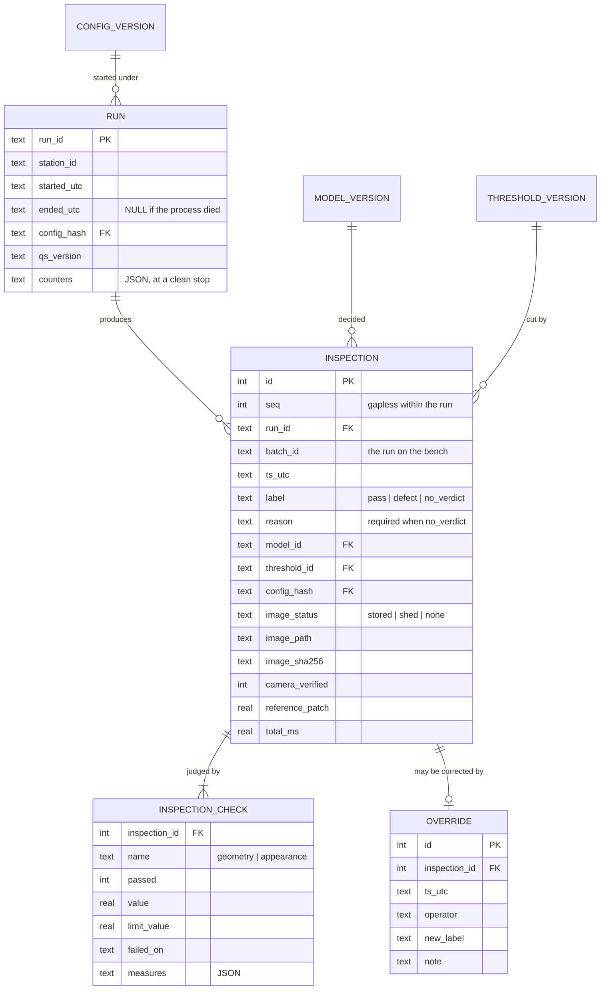

# Data model

**Audience:** engineering. English, per the language policy.
**Status:** design, revised 2026-09-21 (design Step 4): the calibration split, per-check
results, camera read-back, append-only enforced by the schema, and the bench config.
`src/qs/store.py` implements the schema at E0.8.
**Scope:** what is stored on disk — the training datasets, the evidence record, and the
station configuration that ties a verdict to the conditions that produced it.

---

## 1. Three stores, three different jobs

| | Lives at | Written by | Read by | Lifetime |
|---|---|---|---|---|
| **Datasets** | `data/` (git-ignored) | the S2 shoot, and later the factory | training and evaluation | as long as the product exists |
| **Evidence** | `/var/lib/qs` on the edge box; `evidence/` (git-ignored) on the bench | the running station | the operator, QA, us at calibration | records forever, images by retention |
| **Config** | `config/station-*.yml`, in git | us, at install and at each calibration | the station at startup | versioned, never deleted |

## 2. Datasets

```
data/
  raw/<session-id>/                  untouched originals, exactly as shot
    session.yml                      camera read-back, lighting geometry, patch reading,
                                     product, flavour, purchase date, start and end time
    u007_r2.jpg
  datasets/<product>/<geometry>/     one dataset per lighting geometry
    train/good/                      good units only — all the model ever trains on
    calib/good/                      good units that set the threshold and the tolerances
    test/good/                       held-out good units, for the false-alarm rate
    test/<defect-class>/             one folder per class; classes fixed in 14-eval-protocol.md
  golden/<name>/                     frozen replay sets. Never edited, only added to
```

One dataset **per lighting geometry**, because S2's whole question is which geometry
reveals which defect, and that comparison is only fair if each geometry gets its own model
trained and measured under identical conditions.

### The filename is the unit identity

```
u007_r2.jpg     unit 7, rotation 2
```

This is not cosmetic. `04-build-plan.md` plans 40 good units × 3 geometries × 3 rotations
and calls the result "~360 good images". The statistical sample size is **40**, not 360 —
three rotations of the same unit are three views of one sample, not three samples. The
filename convention makes that visible and makes two rules enforceable in code:

- **Split by unit, never by image.** No unit may appear in both `train/` and `test/`. A
  rotation of a training unit sitting in the test set inflates every number we quote.
- **Aggregate by unit at evaluation.** A unit counts as caught if any of its rotations is
  flagged; the denominator is units. [`14-eval-protocol.md`](14-eval-protocol.md) §3.

`session.yml` records what the camera was actually set to, so two shoots a week apart can
be shown to be comparable rather than assumed to be.

## 3. Evidence

Invariant I2: every unit inspected writes an immutable record with its image, its verdict
and enough provenance to reconstruct what decided it. ХАССП traceability has value on its
own; the archive also happens to be the training data for every future retrain.



### The inspection table is append-only

An operator disagreeing with a verdict does **not** update the row. It inserts into
`override`. The original verdict, the machine that produced it and the moment a human
disagreed are all preserved, separately.

That matters three ways. It is what an audit expects of a quality record. It keeps the
measured false-alarm rate honest, because overrides are exactly the false alarms and
erasing them would erase the evidence that the system is drifting. And **the override
stream is the label stream**: every disagreement is a human-labelled example, gathered for
free, which is what the annual retrain is trained on.

```sql
CREATE TABLE run (
    run_id            TEXT    PRIMARY KEY,
    station_id        TEXT    NOT NULL,
    started_utc       TEXT    NOT NULL,
    ended_utc         TEXT,                    -- NULL if the process died
    config_hash       TEXT    NOT NULL,
    qs_version        TEXT    NOT NULL,
    counters          TEXT                     -- JSON, written at a clean stop
);

CREATE TABLE inspection (
    id                INTEGER PRIMARY KEY,
    run_id            TEXT    NOT NULL REFERENCES run(run_id),
    seq               INTEGER NOT NULL,
    batch_id          TEXT    NOT NULL,        -- the run_id on the bench (FR-43)
    ts_utc            TEXT    NOT NULL,

    label             TEXT    NOT NULL CHECK (label IN ('pass','defect','no_verdict')),
    reason            TEXT,

    model_id          TEXT    NOT NULL,
    threshold_id      TEXT    NOT NULL,
    config_hash       TEXT    NOT NULL,

    image_status      TEXT    NOT NULL CHECK (image_status IN ('stored','shed','none')),
    image_path        TEXT,                    -- set only when stored
    image_sha256      TEXT,
    heatmap_path      TEXT,
    unit_x INTEGER, unit_y INTEGER, unit_w INTEGER, unit_h INTEGER,

    exposure_us       INTEGER,
    gain_db           REAL,
    wb_kelvin         INTEGER,
    focus             INTEGER,
    camera_verified   INTEGER NOT NULL CHECK (camera_verified IN (0, 1)),
    reference_patch   REAL,

    capture_ms        REAL,
    inspect_ms        REAL,
    total_ms          REAL,

    UNIQUE (run_id, seq),
    CHECK (label <> 'no_verdict' OR reason IS NOT NULL),
    CHECK ((image_status = 'stored') = (image_path IS NOT NULL AND image_sha256 IS NOT NULL)),
    CHECK (image_status <> 'none' OR label = 'no_verdict')
);

CREATE TABLE inspection_check (
    inspection_id     INTEGER NOT NULL REFERENCES inspection(id),
    name              TEXT    NOT NULL,        -- 'geometry' | 'appearance'
    passed            INTEGER NOT NULL CHECK (passed IN (0, 1)),
    value             REAL,                    -- the anomaly score
    limit_value       REAL,                    -- the threshold ("limit" is reserved in SQL)
    failed_on         TEXT,                    -- e.g. 'diameter_px<min'
    measures          TEXT    NOT NULL DEFAULT '{}',  -- JSON, e.g. {"diameter_px": 412.0}
    PRIMARY KEY (inspection_id, name)
);

CREATE TRIGGER inspection_append_only_u  BEFORE UPDATE ON inspection
    BEGIN SELECT RAISE(ABORT, 'inspection is append-only'); END;
CREATE TRIGGER inspection_append_only_d  BEFORE DELETE ON inspection
    BEGIN SELECT RAISE(ABORT, 'inspection is append-only'); END;
CREATE TRIGGER check_append_only_u       BEFORE UPDATE ON inspection_check
    BEGIN SELECT RAISE(ABORT, 'inspection_check is append-only'); END;
CREATE TRIGGER check_append_only_d       BEFORE DELETE ON inspection_check
    BEGIN SELECT RAISE(ABORT, 'inspection_check is append-only'); END;

CREATE INDEX idx_inspection_batch ON inspection(batch_id, ts_utc);
CREATE INDEX idx_inspection_label ON inspection(label, ts_utc);
CREATE INDEX idx_check_failed     ON inspection_check(name, passed);
```

The two `CHECK` constraints are invariants I6 and C7 written where they cannot be argued
with: a verdict is one of three values, and a `no_verdict` without a stated reason cannot
be inserted at all. The image constraints say the same for the archive: an image is `stored`
with a path and a hash, `shed` under storage failure (ADR-0012), or `none` because no frame was
ever captured — and only a NO_VERDICT can have none. The four triggers do the same for FR-42: append-only is not a coding
convention the application promises to keep, it is a property of the file.

**Why a child table for checks.** One row per check that ran, keyed by inspection and check
name. The alternatives were a column per check (every new check or station is a schema change)
and a JSON blob on the inspection row ("every geometry failure last week" becomes a JSON scan
of every row). The child table is indexable, station-agnostic, and holds Station M's checks
later without a migration. What SQLite cannot check across two tables — rule C8, that the label
agrees with the checks — the Sink asserts before writing, and a verification query re-checks.

### The provenance triple

Every row carries `model_id`, `threshold_id` and `config_hash`. Together they answer, for
any unit inspected at any time in the past year:

> What decided this, under what lighting, at what cut-off — and is that still what is
> running today?

That question is asked exactly once, on the day a customer disputes a batch, and it is
unanswerable after the fact if the columns were not there from the first line of code.

### Image store

```
/var/lib/qs/
    qs.db
    images/<station>/<YYYY>/<MM>/<DD>/<batch>/<seq>_<label>.jpg
    heatmaps/<station>/<YYYY>/<MM>/<DD>/<batch>/<seq>.png
```

`image_sha256` is computed at write. Corruption and tampering are both detectable, and a
verification pass is one query and a walk.

### Sizing and retention

| | Per unit | Per shift, 5,000 units | Per month, 22 shifts |
|---|---:|---:|---:|
| Record | ~400 B | ~2 MB | ~44 MB |
| Image (JPEG q85) | ~500 KB | ~2.5 GB | ~55 GB |
| Heatmap, defects only | ~40 KB | ~10 MB | ~220 MB |

Records are three orders of magnitude smaller than images, which decides the policy:

- **Records: kept forever.** Ten years of them is under 6 GB.
- **Images of defects and overrides: kept forever.** They are the scarcest thing in the
  project and they are the retraining set.
- **Images of passes: retention window**, default 400 days — a year plus a margin, which
  is what a 1–2 TB SSD holds and what a traceability conversation usually reaches back for.

Deletion runs on the edge box, is logged, and never touches a record.

## 4. Configuration is a contract

One versioned file per station. The station loads it at startup and records its hash with
every single verdict.

```yaml
# config/station-A-bench.yml — illustrative values; the pilot and calibration set the real ones
version: 1
station_id: A-bench
product: mochi-<flavour>-v1

trigger:   { type: keyboard, key: space }
camera:
  type: webcam                 # ADR-0010
  device: /dev/video0
  width: 1920
  height: 1080
  format: YUYV                 # uncompressed; MJPG artifacts are texture noise (ADR-0010)
  power_line_hz: 50
  exposure_us: 10000           # manual, a multiple of 10 ms against 100 Hz lamp flicker
  wb_kelvin: 4500
  focus: 30
  capture_timeout_ms: 500      # no frame after t0 in this time: CaptureError

lighting:
  geometry: low_angle          # chosen by the pilot
  reference_patch:
    roi:    [1780, 40, 100, 100]
    expect: 0.62
    band:   0.05               # outside this: NO_VERDICT(lighting)

inspector:
  type: appearance             # ADR-0008, ADR-0009
  localize:  { roi: [360, 0, 1200, 1080], threshold: 70, min_area_px: 20000, border_margin_px: 10 }
  window_px: 800               # fixed window centred on the unit
  input_px:  256               # one resize factor for every unit: 800 to 256
  mask_dilate_px: 12
  model:     patchcore-mochi-v1
  backend:   torch-cuda        # torch-cpu, 4 threads, for the NFR-02 run

threshold:                     # one calibration: the appearance threshold AND the tolerances
  id:     cal-2026-09-25-far5
  value:  1.83
  policy: far_5pct_on_calib
  geometry:                    # derived, never typed — 15-model.md §3
    area_px:        [98000, 131000]
    axis_ratio_min: 0.90
    solidity_min:   0.96

display:
  labels: { pass: ГОДЕН, defect: БРАК, no_verdict: НЕТ РЕШЕНИЯ }
  font:   assets/DejaVuSans.ttf

evidence:  { root: evidence/, retention_days: 400 }
latency:   { budget_ms: 1000, breach_action: record_and_continue }
```

The factory config has the same shape. It differs in trigger, camera, backend, evidence root and
batch source — the blue boxes of `10-architecture.md` §4 and nothing else.

`config_hash` is the SHA-256 of the file in canonical form. Rule C6 in
[`11-interfaces.md`](11-interfaces.md) says every implementation is constructed from this
and nothing else, which is what keeps configuration from drifting into code.

### The threshold is configuration, not part of the model

This is the single most important line in this document, and it is a commercial decision as
much as a technical one.

A model is trained; a threshold is *chosen*, from the held-out good units, against a
false-alarm rate the operator will actually tolerate. They change for different reasons, at
different times, and they version independently:

| Event | What changes | What does not |
|---|---|---|
| Retrain on new data | `model_id` | threshold and tolerances are re-derived, config otherwise stable |
| **Annual calibration visit** | `threshold_id`, maybe `lighting.reference_patch.expect` | `model_id` |
| Lamp replaced | `reference_patch.expect`, `config_hash` | model and threshold |
| Operator says "too many false alarms" | `threshold_id` | `model_id` |

The fourth row is the one that pays. When the client calls to say the station is crying
wolf, the fix is a threshold version and a note in the archive — not a retrain, not a site
visit with a laptop full of PyTorch. The service line the client already agreed to is a
real, bounded piece of engineering work, and this schema is what makes it bounded.

## 5. What is deliberately absent

- **No ORM.** Five tables and a handful of queries. `sqlite3` from the standard library.
- **No migrations framework.** A `schema_version` row and an ordered list of DDL steps.
- **No image database.** Files on disk with hashes in the record. A JPEG in a BLOB column
  is slower to serve, harder to back up and impossible to inspect with `ls`.
- **No network replication.** Invariant I1. The archive stays in the building.
