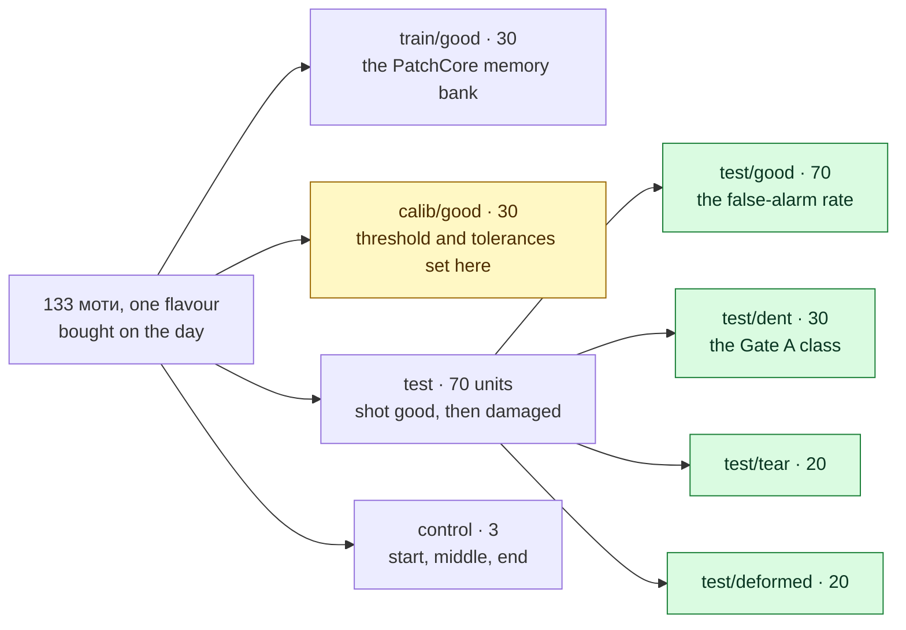

# Evaluation protocol

**Audience:** engineering, and whoever has to defend a number to the client.
**Status:** design, revised 2026-09-21 (design Step 6) for моти, the geometry check, paired
shooting (ADR-0014) and the demo-grade MVP protocol (§9, ADR-0007). `src/qs/eval/` implements
it; `tools/bounds.py` computes every bound quoted here. How the images are taken:
[`13-data-collection.md`](13-data-collection.md).
**This document owns the definition of Gates A and B.** `project.yml` owns whether they
have been passed. Nothing else states a gate criterion.

---

## 1. AUROC is not the number that sells this

The client's acceptance criterion is "up to 95%". AUROC can be 0.98 on a system that flags
one good unit in five, and an operator who is interrupted that often switches it off inside
a week — at which point the detection rate is zero regardless of what the paper said.

The number that matters is a pair, and it is always a pair:

> **At a cut-off that raises false alarms on no more than X% of good units, what fraction
> of real defects do we catch?**

One half without the other is not a result. A system that flags everything catches 100% of
defects; a system that flags nothing has a 0% false-alarm rate. Both are useless and both
produce a quotable number.

## 2. The unit is the sample, not the image

Each unit is shot in 3 rotations — and in the lighting pilot, under 3 geometries as well. That is
up to 9 images of **one** моти. They are views of one sample, not samples: they share the same
dough, the same dusting and the same dent.

`04-build-plan.md` described the S2 output as "~360 good images" and this is the
single easiest place in the project to accidentally multiply our own sample size by nine.
Two rules follow, and both are enforced in code rather than remembered:

- **Split by unit.** No unit may have one rotation in `train/` and another in `test/`.
  The filename convention `u007_r2.png` ([`12-data-model.md`](12-data-model.md) §2) makes
  the check mechanical.
- **Aggregate by unit.** A unit is *caught* if any of its rotations scores above the
  threshold. The denominator of every rate reported is units.

Per-image numbers may be computed for diagnosis. They are never reported as the result.

## 3. Good units split three ways, and the reason is not pedantry

The threshold is **chosen** on `calib/good` and the false-alarm rate is **measured** on
`test/good`, and these must be different units.

If the threshold is set at the 95th percentile of the same good units whose false-alarm
rate you then report, you will report 5% — by construction, every time, whatever the model
does. That is not a measurement, it is arithmetic restating its own input. The number only
becomes evidence when the units it is measured on had no say in where the cut-off went.

The same logic applies one level up. The lighting geometry is **selected in the pilot, on
units that are then thrown away** ([`13-data-collection.md`](13-data-collection.md) §5), and the
gate is evaluated **once**, on untouched units, with the geometry already fixed. Picking the best
of nine geometry × defect-class combinations and quoting it is how a 70% system gets reported
as 90%.

**Paired shooting** (ADR-0014). Each test unit is shot good, damaged by a standard recipe, and
shot again minutes later. Its good images measure false alarms; its damaged images measure recall.
This removes the confound that sinks soft food: if every damaged image is taken an hour after
every good one, the model can tell them apart by *when* — and reports the clock as recall. It also
makes each test unit serve twice: 133 units instead of 170, and 70 good test units instead of 40,
which tightens the false-alarm bound from 7.2% to 4.2%.

## 4. The procedure

For each lighting geometry, in order, with nothing skipped:

1. **Train** PatchCore on `train/good` only. Anomaly detection never sees a defect in
   training — that is the whole point of choosing it (ADR-0002). **Derive the geometry
   tolerances** from the same units (method in `15-model.md`).
2. **Score** every image in `calib/good`, `test/good` and every defect class.
3. **Aggregate to units**: each unit's score is the maximum over its rotations.
4. **Choose the threshold** so that the **combined** verdict — geometry or appearance — meets
   the target false-alarm rate on `calib/good`. For a 5% target on 30 calibration units, that is
   the cut-off leaving at most 1 unit flagged by either check. Record it, with the tolerances,
   as one `threshold_id` ([`12-data-model.md`](12-data-model.md) §4).
5. **Measure**, on units that had no part in steps 1 or 4:
   - recall per defect class, on `test/dent`, `test/tear`, `test/deformed`, for the combined
     verdict — and, as a diagnostic, which check caught each unit
   - the false-alarm rate on `test/good`, combined and per check
   - per test unit, the paired score difference, damaged minus good
6. **Attach a confidence bound to every rate** — §5. A rate without one is not a result.
7. **Repeat at 1%, 5% and 10% targets**, so the operating curve is visible rather than a
   single point chosen to look good.
8. **Measure latency** on CPU, not on the laptop GPU — Gate B, and
   [`10-architecture.md`](10-architecture.md) §5.

## 5. What a sample size can and cannot demonstrate

Generated by `python3 tools/bounds.py`. Exact binomial (Clopper-Pearson) bounds, one-sided,
95% confidence — not the normal approximation, which at n = 20–60 is wrong in the direction
that flatters us.

### Recall — n defective units

|   n | all caught, bound is | 90% caught | bound is |
|----:|---------------------:|---:|---------:|
|   5 | 54.9% | 4/5 | 34.3% |
|  10 | 74.1% | 9/10 | 60.6% |
|  15 | 81.9% | 14/15 | 72.1% |
|  20 | 86.1% | 18/20 | 71.7% |
|  25 | 88.7% | 22/25 | 71.8% |
|  **30** | **90.5%** | **27/30** | **76.1%** |
|  40 | 92.8% | 36/40 | 78.6% |

Read the first row. The plan written on 2026-09-02 called for **5 dents** and a gate of
"≥90% of dents caught". 90% of 5 requires 5 out of 5 — and 5 out of 5 is consistent with a
true catch rate of **54.9%**. That gate could not distinguish a working system from a coin
that landed well. It is retired; see ADR-0005.

The row that matters is n = 30: an observed 27/30 clears a 75% lower bound with 76.1%.
That is why the Gate A defect class is 30 units and not 20 — at 20, an observed 90%
(18/20) yields 71.7% and fails the same bar.

### False alarms — n good units

|   n | none flagged, FAR at most | 5% flagged | FAR at most |
|----:|---------------------:|---:|---------:|
|  10 | 25.9% | 0/10 | 25.9% |
|  20 | 13.9% | 1/20 | 21.6% |
|  30 |  9.5% | 2/30 | 19.5% |
|  **40** |  **7.2%** | **2/40** | **14.9%** |
|  50 |  5.8% | 2/50 | 12.1% |
|  60 |  4.9% | 3/60 | 12.4% |
| 100 |  3.0% | 5/100 | 10.2% |

This table is uncomfortable and it is better to be uncomfortable now than in front of the
client. **Demonstrating a false-alarm rate at or below 5% with 95% confidence requires 59
good units to pass with none flagged.** We will not have that at S3, and pretending
otherwise would be the exact error this document exists to prevent.

So the honest framing, which is also the correct one:

> The false-alarm rate is an **operating point we choose**, not a claim we prove at the
> bench. What S3 demonstrates is the *recall available at that operating point*, plus an
> honest interval on the false-alarm rate itself.

The client's 95% gets proven on the client's line, on their units, in the quantities their
line produces — which is S6, and which is why defective samples from the factory are the
scarcest resource in the project.

## 6. The gates

### Gate A — bench detection · due 2026-10-13

On one flavour of моти, under the lighting geometry selected in the pilot:

| | Requirement |
|---|---|
| A1 | Threshold set to a **5% false-alarm target on `calib/good`** (30 units), recorded as a `threshold_id` |
| A2 | **Dent recall ≥ 90%** on `test/dent`, **n = 30**, aggregated per unit |
| A3 | That recall's **95% one-sided lower bound ≥ 75%** — i.e. at least 27 of 30 |
| A4 | Combined false-alarm rate on `test/good` (70 units) **≤ 10% as a point estimate**, reported with its upper bound |
| A5 | The whole result **regenerated from the frozen golden set by one command** |

A4 is a sanity check, not a confidence claim, and it is labelled as one. §5 shows why a
5% claim at n = 70 holds only if not one good unit is flagged (bound 4.2%); a single false alarm
puts it out of reach (6.6%). A gate that hinges on zero is fragile, and a fragile gate is one that
gets quietly reinterpreted. Tear and deformed recall are reported, not gated.

**If Gate A fails: the problem is the lighting, not the model.** Go back to S2 and
re-shoot. Do not retrain, do not tune hyperparameters, do not add features. The single
most common way a project like this dies is by spending three weeks on the model when the
defect was never in the pixels.

### Gate B — latency · due 2026-10-13

End-to-end trigger-to-verdict **≤ 700 ms at the 95th percentile**, measured on CPU as the
Intel N100 proxy, with persistence off the critical path. Budget breakdown in
[`10-architecture.md`](10-architecture.md) §5.

Measured on at least 200 consecutive inspections, reporting p50, p95 and p99 — not a mean.
A mean hides exactly the stall that makes an operator distrust the station.

## 7. The report

One file per evaluation run, written to `reports/eval/<date>-<product>-<geometry>.md`,
generated, never hand-written. It contains:

- the invocation that regenerates it, and the golden-set hash
- `model_id`, `threshold_id`, `config_hash`
- unit counts per split, and the assertion that no unit crosses splits
- the control units' scores at start, middle and end of each session (E9)
- the operating table: for targets 1%, 5%, 10% — threshold, recall per defect class with
  lower bounds, false-alarm rate with upper bound, and which check caught what
- **INDICATIVE** in the title of every MVP report (ADR-0007)
- latency p50 / p95 / p99
- every unit that changed verdict since the previous run on the same golden set

That last line is the regression test. Once a golden set exists, a change to preprocessing
is not "the numbers look similar" — it is a list of exactly which units moved and why.

## 8. Ways this measurement can lie to us

| | Failure | Guard |
|---|---|---|
| E1 | A unit appears in both train and test | Split by unit prefix; the evaluator asserts disjointness and refuses to run otherwise |
| E2 | Rotations counted as independent samples | Aggregate to units before any rate is computed |
| E3 | Threshold chosen on the set the FAR is reported from | Separate `calib/good` and `test/good` (§3) |
| E4 | Best of nine geometry × class combinations quoted | Geometry selected on calibration data; the gate evaluated once |
| E5 | Hyperparameters tuned until the gate passes | The gate set is touched once per S3 iteration, and re-shooting is the sanctioned response to a failure — not retuning |
| E6 | Deliberate damage is more obvious than real damage | Unfixable at the bench. It is why S5 collects real defective samples, and why Gate A is a bench gate and not a product claim |
| E7 | Two shooting sessions are not comparable | The reference patch reading is recorded per session and checked before the sets are merged |
| E8 | Latency measured on the training GPU | Gate B specifies CPU explicitly |
| E9 | Damaged units shot at a different time from good ones — the model learns the clock | Paired shooting, random order, control units at start, middle and end (ADR-0014) |
| E10 | Handling creates the anomaly — fingerprints in the starch, condensation on a chilled unit | Gloves, a spatula, 30 minutes to room temperature in the packaging ([`13-data-collection.md`](13-data-collection.md) §2) |

E6 is the one that no amount of statistical care fixes, and it should be said out loud
whenever a bench number is shown to anyone: **this measures моти we broke on purpose.**
It establishes that the method works and that the lighting reveals the defect. It does not
establish the client's 95%, and no bench result ever will.

## 9. The MVP protocol — demo-grade

ADR-0007. The same procedure as §4, on fewer units, and every result stamped **INDICATIVE**.
Shooting is in [`13-data-collection.md`](13-data-collection.md) §6.

| Split | Units | Lean |
|---|---:|---:|
| `train/good` | 20 | 18 |
| `calib/good` | 15 | 10 |
| test, paired — `test/good` | 30 | 24 |
| of which `test/dent` · `test/tear` · `test/deformed` | 12 · 9 · 9 | 10 · 7 · 7 |
| control | 3 | 3 |

**What it can show** (`tools/bounds.py`, one-sided 95%):

| | Observed | Bound |
|---|---|---:|
| Dent recall, n = 12 | 12 of 12 | ≥ 77.9% |
| | 11 of 12 | ≥ 66.1% |
| Tear or deformed recall, n = 9 | 9 of 9 | ≥ 71.7% |
| False alarms, n = 30 | 0 of 30 | ≤ 9.5% |
| | 1 of 30 | ≤ 14.9% |

So the MVP can show that the method works and that the lighting reveals the defect. It cannot
show the client's 95%, nor Gate A. The threshold on 15 calibration units cannot resolve a 5%
target — one unit is 6.7% — so the MVP cut-off is the highest calibration score, reported as such.

**Placement set.** Ten frames with no unit or a unit touching the edge go into the golden set.
Every one must come back NO_VERDICT(`placement`) — a functional check, not a statistic.

**Early warning** (`06-requirements.md` §4). Dent recall under 70% at the 5% target — fewer than
9 of 12 — means stop and fix the lighting before building more of the demo. The same rule as
Gate A, applied early.

**Golden set.** `data/golden/mvp-<date>/`, frozen with a content hash. The MVP report is
regenerated from it by one command (FR-56).
