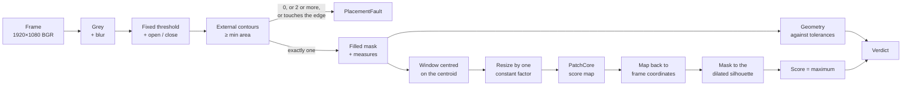
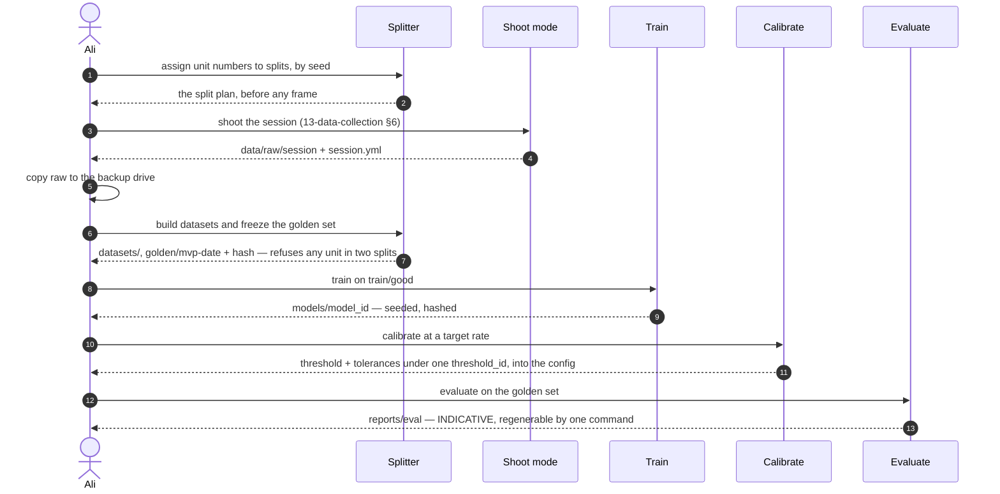

# 15 · Model and training — Station A's Inspector

**Audience:** engineering. English, per the language policy.
**Status:** design, 2026-09-21 (design Step 7). Library facts, licences and latency researched the
same day, with sources inline.
**Requirements:** FR-22 to FR-26, FR-53 to FR-56, NFR-01 to NFR-03, NFR-11.
**Decisions:** ADR-0008 (geometry in code), ADR-0009 (localize, then judge the unit), ADR-0015
(PatchCore from Anomalib, at the torch-model level).

Everything here is a pure function of the frame, the model bundle and the config (C1, C2). No
step reads the clock, the disk or the network.

---

## 1. The chain



## 2. Finding the unit

| Step | How | Why |
|---|---|---|
| Grey | `cv2.cvtColor(BGR→GRAY)` inside the localize ROI only | A pale unit on black is a brightness problem, not a colour one |
| Blur | Gaussian, 5 × 5 | Starch specks and sensor noise do not become contour edges |
| Threshold | **Fixed** value from config, set at the pilot from the histogram | Deterministic and predictable. Otsu adapts per frame, and would follow a lighting drift that the reference patch is supposed to catch instead |
| Clean | Morphological open then close, 5 px ellipse | Dust specks gone, pinholes closed |
| Contours | `RETR_EXTERNAL`, area ≥ `min_area_px` | Only outer outlines; small debris ignored |
| Fill | The outer contour drawn filled | A tear showing dark filling must not punch a hole in the mask — the tear is appearance's job, not geometry's |

**Placement rules** (FR-25), in order: no contour → `PlacementFault("no unit")`; two or more →
`PlacementFault("more than one unit")`; the one contour's bounding box closer than
`border_margin_px` to the ROI edge → `PlacementFault("not wholly in view")`.

Two units stuck together form **one** contour of the wrong shape. That is a DEFECT by geometry,
which is correct: it is what the client would call one.

## 3. Geometry

Four numbers from the filled mask:

| Measure | Definition | Catches |
|---|---|---|
| `area_px` | Pixels in the filled mask | Under- and oversize; flattening (a flattened unit spreads) |
| `diameter_px` | √(4·area/π) — reported for people, not tested | The same as area, in units a person reads |
| `axis_ratio` | Minor / major axis of `cv2.fitEllipse` on the contour | Oval deformation |
| `solidity` | area / convex-hull area | Notches and irregular outlines — a torn edge, a pinched side |

Roundness is measured two ways because it fails two ways: a squeezed unit is smooth but oval
(axis ratio), a torn one is round but notched (solidity). Perimeter-based circularity is not used —
it is dominated by pixel-level jaggedness of the edge.

**Tolerances are derived, never typed.** From every good unit outside the test set — `train/good`
plus `calib/good` — each unit's measures are averaged over its rotations, then:

- `area_px` — [min − 3σₙ, max + 3σₙ]
- `axis_ratio_min`, `solidity_min` — min − 3σₙ

where σₙ is the **measurement noise**: the pooled standard deviation of each measure across
rotations of the same unit. The observed range of real units, widened by what the measurement
itself cannot resolve. Twenty-odd units underestimate the population's range, so some good units
will fall outside; `14-eval-protocol.md` §4 step 5 measures how many, on test units that played no part.

## 4. The window PatchCore sees

A square of `window_px` centred on the mask's centroid, cut from the frame. Where it runs past the
frame edge it is padded with black — the background it would have seen. Then one resize, `INTER_AREA`,
from `window_px` to `input_px`, the **same factor for every unit** (ADR-0009). `window_px` is set at
the pilot to about twice the typical diameter, so the whole unit and a margin of floor are in view.

## 5. PatchCore

**Library** (ADR-0015). `anomalib==2.6.2` (released 2026-09-11, Apache-2.0), pinned exactly —
minor versions arrive about monthly and the 2.0 rework changed the core API. Only its torch model
is used: `PatchcoreModel`, fed tensors that our own §2–§4 produced. **Not used:** the Lightning
`Engine`, the `Folder` datamodule, Anomalib's pre-processor and post-processor. The reasons are
specific:

- `Folder` splits by **image** (`normal_split_ratio=0.2` by default) — rotations of one training unit
  would land in test, which is error E1.
- The default post-processor normalises scores to [0, 1] against a threshold of its own and clamps
  them. We set our own threshold (§7) and need the raw distance.
- The default pre-processor resizes whatever it is given to 256 × 256. Our window is already cut and
  resized by one constant factor (§4); a second resize is at best redundant.

Both processors belong to the Lightning wrapper `Patchcore`, not to the torch `PatchcoreModel`, so
using the torch model directly avoids them. If the wrapper is ever used to build it, both are passed
as `False`. **To be confirmed against 2.6.2 at the environment step.**

**Configuration**

| Setting | Value | Note |
|---|---|---|
| Backbone | `wide_resnet50_2`, ImageNet-pretrained | Loaded through timm from the Hugging Face Hub (`timm/wide_resnet50_2.tv_in1k`, the original torchvision weights) — **confirm at the environment step**. The licence question in §11 applies |
| Layers | `layer2`, `layer3` | Anomalib's default and the paper's |
| Input | 256 × 256, ImageNet mean and std | A 32 × 32 patch grid |
| Coreset | 10% | 1% is the first latency fallback (§10) |
| Neighbours | 9 | For the paper's re-weighting |
| Precision | float32 | |
| Seed | Global, set before subsampling | See below |

**Seeding is ours to do.** Anomalib's greedy coreset picks its first centre with `torch.randint`, and
its sparse random projection draws on NumPy's global generator. Neither takes a seed. Without
`torch.manual_seed` and `numpy.random.seed` immediately before subsampling, every training run builds
a different memory bank (§9).

**Training is one pass** — feature extraction over `train/good`, then subsampling; no epochs, no
optimiser. On the laptop's RTX 3050 (4 GB), in batches of 8: the full embedding before subsampling is
~61k patches × 1,536 values ≈ 375 MB, well inside memory.

**What comes out.** In eval mode the model returns a raw `pred_score` and an `anomaly_map` at input
size. We use the map, masked, for the score (§6); `pred_score` is logged alongside as a cross-check.

**Is 20 units enough?** PatchCore is strong with little data. Reported MVTec image AUROC:
91.0 at 5 images, 95.9 at 20, 97.7 at 50 ([arXiv 2308.12577](https://arxiv.org/html/2308.12577)).
Our 20 units give 60 images, but rotations of one unit are correlated, so the honest comparison is
closer to 20 than to 60. AUROC is not our measure; §7 and `14-eval-protocol.md` are.

**Checked against the reference.** S1 runs the same code path on one MVTec AD category and must land
near Anomalib's published number — validation only, never shipped (R8). A second implementation is
kept in reserve: ~150–200 lines on torchvision (layer hooks, 3 × 3 average pooling, seeded greedy
coreset, exact `torch.cdist`). It is built only if the pinned API gets in the way, and it must match
Anomalib's scores on the same MVTec images before it replaces it.

**Export** to OpenVINO is product scope (FR-57). It will be done on our own wrapped model, because
Anomalib's exporter bakes its pre- and post-processor into the graph.

## 6. From map to score

1. The anomaly map at `input_px` is upsampled back to `window_px` and stays in window coordinates;
   `window_box` records where the window sits in the frame (`11-interfaces.md` §2).
2. It is **masked** to the unit's silhouette dilated by `mask_dilate_px`. Background pixels are set
   to zero (ADR-0009).
3. **Score = the maximum** of the masked map — PatchCore's own image-score definition, restricted to
   the unit.
4. A non-finite score raises `InferenceError` (F7), never a verdict.

**The heatmap on screen** (FR-23, FR-33) is the masked map divided by the threshold, clipped to
[0, 1.5], coloured, and blended over the unit only. **In the store** it is the same ratio clipped to
[0, 2] and saved as a uint8 PNG (× 127.5). A value of 1.0 means exactly at the threshold,
so the colour means the same thing on every unit, every day. A geometry DEFECT shows the outline
instead, with the failing measure against its tolerance.

## 7. Calibration — one step, one `threshold_id`

The offline flow end to end — the second critical flow after inspecting one unit
(`10-architecture.md` §5):




Run once per trained model, on units the model never saw:

1. **Tolerances** from `train/good` ∪ `calib/good`, per §3.
2. **Appearance scores** on `calib/good` only. Training units score low by construction — they
   *are* the memory bank — so a threshold set on them would flag half the line.
3. **Threshold** — the lowest value at which the **combined** verdict, geometry or appearance,
   flags no more than the target share of `calib/good` units. For the MVP's 15 units a 5% target
   cannot be resolved (one unit is 6.7%), so the threshold is the highest calibration score:
   0 of 15 flagged, reported as exactly that (`14-eval-protocol.md` §9).
4. Everything written into the config under one new `threshold_id`, with the policy and the unit
   counts it was set on.

Geometry false alarms on calibration units are reported separately. If geometry alone already
flags more than the target, the tolerances are the problem — widen, and say so — not the threshold.

## 8. The model bundle

```
models/<model_id>/
    memory_bank.pt         the coreset
    bundle.yml             backbone, layers, input_px, window_px, normalisation, seed,
                           library versions, data_source (own | external:<name>),
                           the unit IDs trained on, and the hash of every training image
```

`model_id = patchcore-<product>-v<n>-<first 12 hex of sha256(memory_bank.pt + bundle.yml)>`.
The station refuses to start if the bundle's hash does not match the `model_id` in its config
(`16-failure-model.md` §2).

- **Unit IDs, not only image hashes.** Another rotation of a training unit has a different hash, so
  the evaluation harness checks the bundle's **unit IDs** against the test set's.
- **`data_source` other than `own` makes the bundle validation-only**, and the station refuses it
  outside validation mode (ADR-0016).
- **One source of truth.** `window_px`, `input_px` and normalisation live here and nowhere else; the
  config names the bundle by its full `model_id`.

## 9. Determinism

C1 requires the same score for the same frame, model and threshold. Three sources of variation are
closed:

- **Coreset sampling** is random in PatchCore; it is seeded, and the seed is in `bundle.yml`.
- **Nearest-neighbour search** is exact — no approximate index — so the same query finds the same
  neighbour.
- **Backend.** CUDA and CPU give slightly different floats. A bundle is calibrated on one backend
  and the config names it; switching backends means recalibrating (`16-failure-model.md` §3).

On CUDA, before the model loads: `torch.backends.cudnn.deterministic = True`,
`torch.backends.cudnn.benchmark = False`, `torch.use_deterministic_algorithms(True)`.

The NFR-02 run on CPU measures latency only; its scores decide nothing.

Test: the same 20 frames inspected twice give identical scores to 1e-6 (NFR-03).

## 10. Latency

**Budgets:** 400 ms of inference on the N100 (`10-architecture.md` §5, Gate B); 1.0 s end to end on
the laptop for the MVP (NFR-01).

**What is known** — researched 2026-09-21:

| Measurement | Result | Source |
|---|---|---|
| PatchCore, WideResNet-50, desktop i5-9600K | 345 ms per image | [arXiv 2603.20288](https://arxiv.org/html/2603.20288) |
| PatchCore, WideResNet-50, 224 px, laptop i7-9750H | 467 ms; ~40 ms with the bank capped at 1,000; 88 ms at 5,000 — whether the backbone is included is not stated | [arXiv 2605.27748](https://arxiv.org/html/2605.27748) |
| Anomalib PatchCore on a laptop GPU | search 36 ms, heatmap blur 25 ms, backbone 8 ms | [anomalib #3780](https://github.com/open-edge-platform/anomalib/issues/3780) |
| N100 against an i5-1235U (PassMark) | 0.62× single-thread, 0.43× multi-thread | [PassMark](https://www.cpubenchmark.net/compare/4765vs5157/Intel-i5-1235U-vs-Intel-N100) |

**No published PatchCore measurement on an N100 was found**, with or without OpenVINO.

**Our memory bank.** 20 units × 3 rotations × 1,024 patches (a 32 × 32 grid at 256 px input) ≈ 61k
patches — about 6k at a 10% coreset, 600 at 1%.

**Estimate, labelled as one.** On an N100, WideResNet-50 feature extraction ~150–300 ms and a search
against ~6k patches ~50–120 ms. The default configuration is **borderline** for 400 ms; ResNet-18
or a 1% coreset fits with room.

**Measurement (NFR-02).** The laptop with the GPU hidden and PyTorch pinned to 4 threads, 200
consecutive inspections replayed from the golden set, looping over it when it holds fewer frames
(the lean set has about 180). p50, p95 and p99 for the backbone, the search and
the whole inspection, separately. The N100 figure is reported as the laptop's × 2 to × 3 — a range,
not a number — and Gate B is judged on its top end: laptop p95 inspection time × 3 ≤ 400 ms
(ADR-0017), until an N100 exists (Gate C).

**If it misses, in this order**, each step measured on the golden set before the next:

1. **Coreset 10% → 1%.** The cheapest accuracy per millisecond saved.
2. **Input 256 → 224 px.** 784 patches per image instead of 1,024.
3. **Backbone WideResNet-50 → ResNet-18.** Anomalib's MVTec table: image AUROC 0.980 → 0.973.
4. **PaDiM.** A published 24 ms CPU variant exists; a different model, so evaluated from scratch.

Approximate nearest-neighbour search is not on the list: the PatchCore paper found it lost accuracy
and was still slower than a 1% coreset. It would also break exact determinism (§9).

## 11. Licences — closes OQ-7

Researched 2026-09-21; sources in the table. **A shape, not legal advice** — the open item goes to
the lawyer budget line (CLAUDE.md §6).

| Component | Licence | Commercial use | Caveat | Source |
|---|---|---|---|---|
| Anomalib, incl. PatchCore and PaDiM | Apache-2.0 (Intel) | Yes | PatchCore and PaDiM are Intel's own code, not third-party | [LICENSE](https://github.com/open-edge-platform/anomalib/blob/main/LICENSE) |
| Anomalib FastFlow | Apache-2.0 (third party) | Yes | Keep the attribution | [third-party-programs.txt](https://github.com/open-edge-platform/anomalib/blob/main/third-party-programs.txt) |
| Anomalib EfficientAD | Apache-2.0 code | **Unclear** | Downloads extra pretrained teacher weights with no licence found, and trains on Imagenette | [docs](https://anomalib.readthedocs.io/en/stable/markdown/guides/reference/models/image/efficient_ad.html) |
| torchvision `wide_resnet50_2`, `resnet18` weights | None stated | **Unresolved** | torchvision: weights "may have their own licenses… your responsibility to determine" | [models](https://docs.pytorch.org/vision/stable/models.html), [vision#2597](https://github.com/pytorch/vision/issues/2597) |
| ImageNet images | Terms of access | No | Non-commercial research and education only | [image-net.org](https://www.image-net.org/download.php) |
| MVTec AD | CC BY-NC-SA 4.0 | No | Nothing trained on it ships | [MVTec](https://www.mvtec.com/company/research/datasets/mvtec-ad) |
| OpenVINO | Apache-2.0 | Yes | — | [LICENSE](https://github.com/openvinotoolkit/openvino/blob/master/LICENSE) |
| OpenCV ≥ 4.5 | Apache-2.0 | Yes | We use `opencv-python-headless` (Anomalib requires it; ADR-0018). Its wheels bundle FFmpeg (LGPL-2.1) — an obligation only if we redistribute the wheel | [opencv-python](https://github.com/opencv/opencv-python) |
| Pillow | MIT-CMU | Yes | Keep the notice | [LICENSE](https://github.com/python-pillow/Pillow/blob/main/LICENSE) |
| PyTorch | BSD-3-Clause | Yes | — | [LICENSE](https://github.com/pytorch/pytorch/blob/main/LICENSE) |
| DejaVu Sans | Bitstream Vera; changes public domain | Yes, bundled | Not sold alone; keep the notice | [licence](https://dejavu-fonts.github.io/License.html) |

**What is settled and what is not about the backbone weights.** Settled: the ImageNet images are
non-commercial, and neither torchvision nor timm attaches a licence to the weights. Contested:
whether the dataset's terms reach the weights. One position holds that weights contain no images
and may not be copyrightable at all ([arXiv 2412.07066](https://arxiv.org/pdf/2412.07066)); the
other says to assume the dataset's terms apply and to take advice. These backbones ship in many
commercial products — which is practice, not a ruling.

**Consequences for this project**

- **The MVP ships nothing.** Whether demonstrating it to a paying prospect is itself affected is a
  question for the lawyer line, not a conclusion drawn here.
- **Before anything ships to the client, the backbone question goes to a lawyer.** It is the one
  licence risk in the stack, and every PatchCore variant carries it. The fallbacks, in order of
  cost: a backbone pretrained on a commercially licensed dataset, or self-supervised pretraining
  on our own unlabelled line images — the evidence store collects them for free.
- **EfficientAD is excluded** as a fallback model.
- **MVTec AD stays validation-only** (R8, unchanged).
- **OpenCV is headless everywhere** (ADR-0018), so the non-headless wheels' Qt LGPL question never
  arises; the FFmpeg notice is kept if a wheel is ever redistributed.
- **Access from Russia.** Intel paused and then restored software downloads in 2022; no current
  block on PyPI, `download.pytorch.org` or the Hugging Face Hub was found, but none was verified
  either. Keep a local
  wheel cache of every pinned dependency from the first install (NFR-12).
