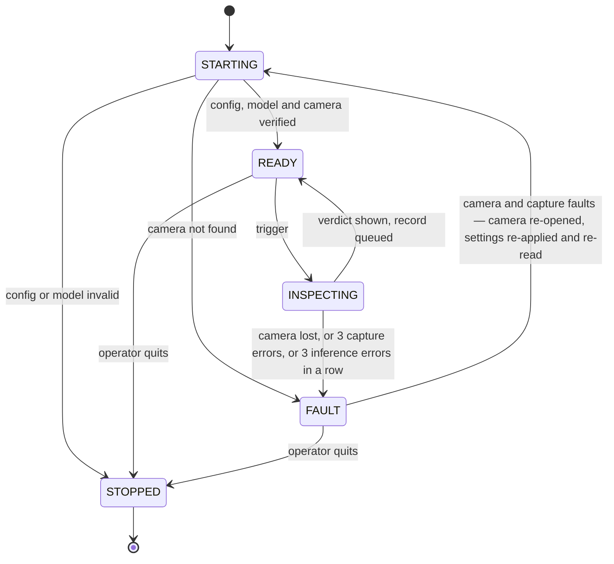
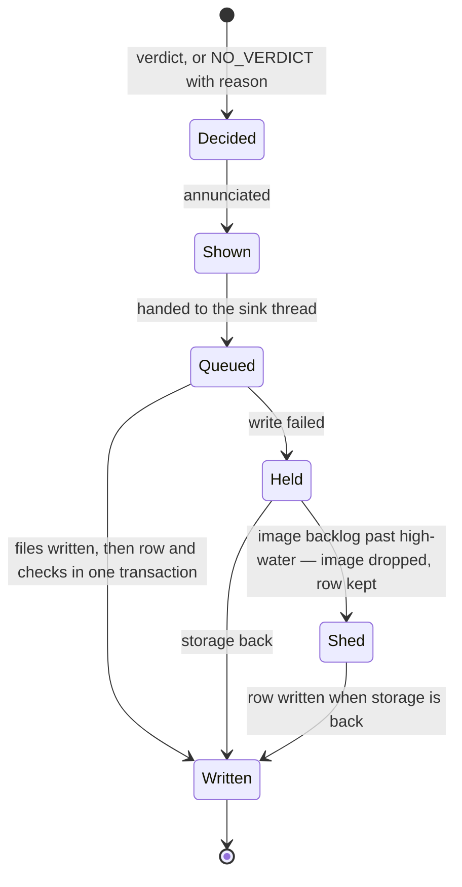

# 16 · Failure model

**Audience:** engineering. English, per the language policy.
**Status:** design, written 2026-09-21 (design Step 5). Implements E0.6.
**Requirements:** FR-24, NFR-04, NFR-05, NFR-06 in [`06-requirements.md`](06-requirements.md);
invariants I6 and I9; contract rules C3, C4, C5, C7, C8. Decision: `decisions/ADR-0012`.

---

## 1. The rule

**Every trigger ends in exactly one record and one thing on the screen.** A verdict, or
NO_VERDICT with a reason. Nothing fails silently, and nothing fails to PASS.

That gives three outcomes, and every failure below lands in one of them:

| Outcome | Label | What the operator does |
|---|---|---|
| Decided | ГОДЕН / БРАК | Packs, or sets aside |
| Review required | НЕТ РЕШЕНИЯ + reason | Checks this unit by hand |
| Station not checking | FAULT screen | Checks every unit by hand until it clears |

## 2. Station states

| State | Entered when | Operator sees | A trigger produces |
|---|---|---|---|
| STARTING | Launch, or recovery from FAULT | "ЗАПУСК" | Key press: discarded. Unit trigger (factory): NO_VERDICT(`busy`) |
| READY | Every start-up check passed | Live view, "ГОТОВ" | An inspection |
| INSPECTING | A trigger arrived | The previous verdict | Key press: discarded and counted. Unit trigger (factory): NO_VERDICT(`busy`) — accounted for, not checked |
| FAULT | Camera lost, or 3 capture errors, or 3 inference errors in a row | Full amber screen: "СТАНЦИЯ НЕ ПРОВЕРЯЕТ" and the fault's own reason | NO_VERDICT with the fault's reason — `camera`, `capture` or `inference` |
| STOPPED | Quit, window closed, or a start-up check failed | Nothing; exit code and message | — |

**Warnings are not states.** Four conditions change what the screen shows, not what the station
does, and any number can be active at once:

| Warning | Raised when | Cleared when |
|---|---|---|
| `LIGHTING` | A captured frame's reference patch is outside the band | A captured frame is back inside it |
| `CAMERA_SETTINGS` | A readable setting differs from config (that unit is NO_VERDICT, F4), or a setting cannot be read at all (units are inspected as normal, recorded with `camera_verified = 0`) | Read-back matches again; never, for an unverifiable camera |
| `STORAGE` | A write fails, or the image backlog passes its high-water mark | The backlog is written |
| `LATENCY` | More than 10% of the last 50 inspections broke the budget | Back under 10% |

### Start-up, in order, each check failing closed

1. **Config** parses and validates; its hash is computed. Otherwise STOPPED, exit code 2.
2. **Model bundle** exists and its weights hash matches the `model_id` named in the config.
   Otherwise STOPPED. The station never runs a model its config did not name.
3. **Camera** opens, settings are applied and read back. Not found: FAULT, retrying. A value
   read back different from what was set — a clamped exposure, say — is a config error: STOPPED,
   with the mismatch printed. A value that cannot be read at all: start, with `CAMERA_SETTINGS`.
4. **Warm-up.** One inference on a blank frame, so the first real unit does not pay for loading
   weights onto the GPU.
5. **Reference patch** on the first frame. Out of band: start, with `LIGHTING`.

## 3. Every failure, and what happens

| | Failure | Detected by | This unit | Station | Clears when |
|---|---|---|---|---|---|
| F1 | Camera unplugged or lost | `CameraLost` | NO_VERDICT(`camera`) | FAULT(camera); reconnect at 0.5, 1, 2, 4, 8, then every 10 s | Reconnected and settings re-verified |
| F2 | No frame after the trigger within the timeout | `CaptureError` | NO_VERDICT(`capture`) | Stays READY; FAULT(capture) after 3 in a row, which re-opens the camera as F1 does | Next good capture; from FAULT, as F1 |
| F3 | Only a stale frame available | `capture()` waits for one stamped after `t0` (C4) | Never inspected; becomes F2 on timeout | — | — |
| F4 | Settings drift — auto re-enabled, exposure changed | A readable value differs on a capture: `CameraSettingsDrift` | NO_VERDICT(`camera_settings`) | `CAMERA_SETTINGS` | Read-back matches |
| F5 | Lighting out of band — lamp moved, box open, bulb ageing | Reference patch (FR-14) | NO_VERDICT(`lighting`) | `LIGHTING` | A frame back in band |
| F6 | No unit, or unit not wholly in the area | `PlacementFault` (FR-25) | NO_VERDICT(`placement`) | Stays READY — an operator event, not a fault | — |
| F7 | Inference fails — CUDA error, non-finite score, any exception inside `inspect()` | `InferenceError` | NO_VERDICT(`inference`); partial results discarded (C8) | FAULT(inference) after 3 in a row. **No automatic exit** — a model failing three times running is not retried blindly | The operator restarts the station |
| F8 | Inspection over the latency budget | Timing | The verdict stands; the breach is counted | `LATENCY` above 10% of the last 50 | Back under 10% |
| F9 | A unit trigger (factory photoelectric) while inspecting or starting | Pipeline | NO_VERDICT(`busy`), no image | — | — |
| F10 | Key presses during an inspection, or a key held down | `KeyboardTrigger`: a press is accepted only ≥ 300 ms after the previous event finished | Discarded and counted; no record — a key press is not a unit | — | — |
| F11 | Evidence write fails — disk full, permission | The sink thread | Verdict shown on time; record held in memory | `STORAGE`; images shed per ADR-0012 | Backlog written |
| F12 | Screen fails to draw | Annunciator | Record still written | Logged | — |
| F13 | Window closed | Screen | — | STOPPED once the queue is written. If storage is down, it waits up to 10 s, then exits and prints how many rows were lost (ADR-0012) | — |
| F14 | Process killed | — | At most the in-memory backlog is lost | SQLite commits are atomic; see §4 | Restart |
| F15 | Corrupt frame — wrong shape or dtype, or flat (every pixel within 1 grey level) | Capture validation | NO_VERDICT(`capture`) | As F2 | Next good capture |

Two things are deliberately **not** handled automatically:

- **No fallback from GPU to CPU.** The two backends give slightly different scores, and the
  threshold was calibrated on one of them. A silent switch would quietly change what БРАК means.
  An inference failure is F7, not a change of backend.
- **No automatic threshold change**, for any reason. A threshold changes by a new calibration, with
  a new `threshold_id` (`12-data-model.md` §4).

## 4. The record's lifecycle

**Files first, row last, one transaction per record.** The image and heatmap are written and
hashed first; then the inspection row and its check rows are committed together. A row therefore
always has its files. A crash between the two steps leaves an orphan image with no row, which is
harmless and which a verification pass lists.

**Under storage failure the verdict wins, and the record outlives the image** (ADR-0012). Rows
are ~400 B and stay queued in memory while the process lives. Images are ~500 KB and are shed —
PASS images first, then the rest — once the backlog passes its high-water mark. A shed image
leaves its row with `image_status = 'shed'`: the gap in the archive is recorded, not silent.

## 5. What the operator sees

Russian, from `display` in the station config; the wording is a draft for Ali to correct.

| Situation | Screen |
|---|---|
| Ready | Live view, status bar **ГОТОВ** |
| PASS | Green, **ГОДЕН** |
| DEFECT | Red, **БРАК**, heatmap or the failed measurement |
| NO_VERDICT, placement | Amber, **НЕТ РЕШЕНИЯ** — *положите изделие в рамку* |
| NO_VERDICT, lighting | Amber, **НЕТ РЕШЕНИЯ** — *проверьте освещение* |
| NO_VERDICT, capture or camera settings | Amber, **НЕТ РЕШЕНИЯ** — *нет кадра* / *настройки камеры изменились* |
| NO_VERDICT, inference | Amber, **НЕТ РЕШЕНИЯ** — *ошибка анализа* |
| NO_VERDICT, busy | Amber, **ИЗДЕЛИЕ НЕ ПРОВЕРЕНО** |
| FAULT | Full amber screen, **СТАНЦИЯ НЕ ПРОВЕРЯЕТ** — *камера не подключена* / *нет кадров* / *ошибка анализа — перезапустите станцию* |
| Warnings | A banner: *архив не записывается* · *освещение вне нормы* · *настройки камеры не подтверждены* · *медленная работа* |

Amber for every NO_VERDICT, never green (C7). The FAULT screen replaces the live view entirely,
because a live picture on a station that is not checking looks exactly like one that is.

## 6. Counters

Per run, shown in the session panel and written to the `run` row at a clean stop:

- events; PASS, DEFECT, and NO_VERDICT by reason
- faults by type; reconnect attempts; key presses discarded
- records written, held and shed; images shed
- latency p50 / p95 over the last 50, and budget breaches
- whether the camera was verified

Everything except the held and shed counts can be recomputed from the inspection rows if the
process dies, which is why only those two are the reason the `run` row is written at stop.

## 7. Fault injection — the tests behind NFR-04

Each line is an automated test, run through `ReplaySource` or a scripted fake. None needs a camera.

| Inject | Expected |
|---|---|
| Camera lost at event k | FAULT; later triggers NO_VERDICT(`camera`); recovery to READY once the fake reconnects; `seq` gapless throughout |
| No frame after `t0` | NO_VERDICT(`capture`) within timeout + 50 ms |
| A flat frame; a frame of the wrong shape | NO_VERDICT(`capture`) |
| A readable exposure changes mid-run; then settings that cannot be read | NO_VERDICT(`camera_settings`); then normal verdicts recorded with `camera_verified = 0` |
| Newest frame older than `t0` | Never inspected; waits, then NO_VERDICT(`capture`) |
| Reference patch darkened | NO_VERDICT(`lighting`); `LIGHTING` raised; cleared by the next in-band frame |
| Empty frame; unit touching the edge | NO_VERDICT(`placement`); the fault counter unchanged |
| Inspector returns a non-finite score | NO_VERDICT(`inference`); FAULT(inference) on the third in a row; no automatic exit |
| Evidence directory read-only for 100 events | Every verdict within NFR-01; `STORAGE` raised; rows held; PASS images shed past high-water; on restore, every held row written; counts exact |
| Sink raises `OSError(ENOSPC)` | As above |
| Process killed mid-run | Database opens; every row's files exist; orphans listed by verification |
| Keys fed during an inspection; a key held for 2 s (fake screen, fake clock) | No event from a press within 300 ms of the previous event finishing; each discarded press counted; no record for it |
| A unit trigger during an inspection (fake photoelectric) | NO_VERDICT(`busy`), no image, `seq` gapless |
| Window closed | STOPPED; queue drained; `run.ended_utc` set |
| Window closed while storage is down | Exits within 10 s; the number of rows lost is printed |

## 8. Not handled, deliberately

- **No watchdog on the bench.** The factory runs under systemd with restart on failure.
- **No power-loss handling** beyond SQLite's atomic commit.
- **No operator override** in the MVP (FR-36 is product scope); the schema already holds it.
