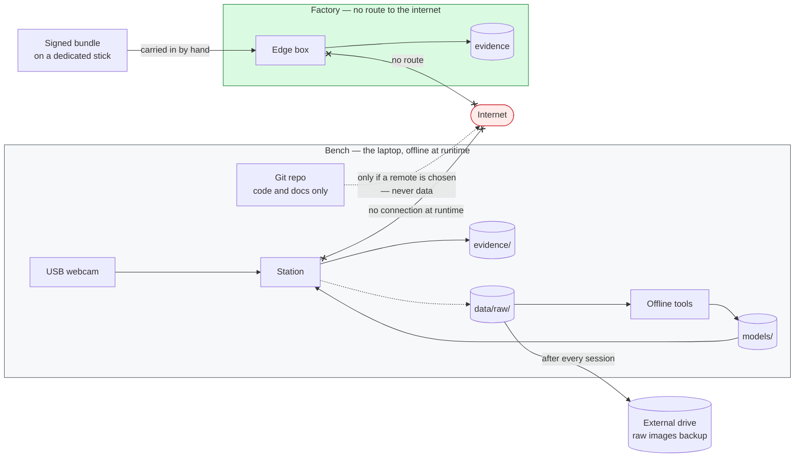

# 17 · Security and data handling

**Audience:** engineering, and anyone asked "where do the pictures go?". English, per the language
policy.
**Status:** design, written 2026-09-21 (design Step 8).
**Requirements:** NFR-07, NFR-11, NFR-12, FR-42, FR-63; invariants I1, I2, I8. Decision: ADR-0016.
**Legal answers here are shape, not advice** — anything that turns on the law goes to the lawyer
budget line (CLAUDE.md §6).

---

## 1. What is worth protecting

| | Asset | What matters | Why |
|---|---|---|---|
| A1 | Product images | Confidentiality | At the factory, the client's product and line are a trade secret. On the bench, store-bought моти are not — but the habits are built now |
| A2 | Evidence records | **Integrity** | A traceability record that can be quietly edited is worth nothing in a dispute (ХАССП) |
| A3 | Model bundle, config, threshold | **Integrity** | A changed threshold changes what БРАК means over open food — a safety property, not a setting |
| A4 | Client information in the repo | Confidentiality | Survey answers, commercial terms, the acceptance number |
| A5 | People in frame | Privacy — 152-ФЗ | A camera in a factory can capture workers. This one is built not to |
| A6 | Raw shoot images | **Availability** | Perishable product: a lost shoot cannot be re-shot from the same units |

There are no credentials, user accounts or network services to protect. Not having them is the
first control.

## 2. Boundaries

The only data that ever crosses a boundary is code and documentation, and only if a git remote is
chosen (open, Step 10). Images, records and models never do.

## 3. Threats

STRIDE, trimmed to what applies. Scope: **MVP** = built this week; **Product** = before the factory.

| | Threat | Against | Control | Scope |
|---|---|---|---|---|
| T1 | Images leave the building over the network | A1 | No network calls at runtime (NFR-07); no route to the internet at the plant (I1); `data/`, `evidence/`, `models/` git-ignored | MVP |
| T2 | Evidence records edited or deleted | A2 | Append-only triggers in the schema (FR-42); SHA-256 of every image in its row. Tamper-*evident*, not tamper-proof: whoever owns the file can still replace it | MVP |
| T2b | The whole database replaced | A2 | A daily digest — the hash of the day's rows and image hashes — printed or handed to QA, so a later swap is detectable | Product |
| T3 | Model, config or threshold changed | A3 | The station checks the bundle hash against `model_id` and records `config_hash` on every row (`16-failure-model.md` §2); updates only as a signed bundle (FR-63) | MVP (hashes) · Product (signing) |
| T4 | A model trained on non-commercial data runs in production | A3, licence | The bundle records its data sources; a bundle trained on MVTec AD is tagged `validation-only` and the station refuses it outside validation (ADR-0016) | MVP |
| T5 | The station downloads something at runtime | A1, A3 | Pretrained weights and every wheel fetched once at setup, hashed, cached locally; the station runs with the cache and the network off, and a test proves it (ADR-0016) | MVP |
| T6 | A compromised or changed dependency | A3 | Exact pins with hashes (`pip --require-hashes`), a local wheel cache, updates only as a deliberate commit | MVP |
| T7 | Operator changes settings or reaches a shell | A3 | Kiosk session, config owned by root, no operator shell | Product |
| T8 | Malware carried in on the calibration stick | Plant | One dedicated stick, scanned before every visit, carrying only the signed bundle | Product |
| T9 | The box is stolen | A1, A2 | Full-disk encryption on the edge box | Product — decided with the client |
| T10 | Disk full, camera unplugged | Availability | `16-failure-model.md`, ADR-0012 | MVP |
| T11 | A shoot is lost to a disk failure | A6 | `data/raw/` copied to a second device after every session — the phone over USB, no network | MVP |

## 4. People in frame — 152-ФЗ

The station is built so that it processes no personal data:

- **The camera looks straight down, inside a shroud, at the product.** Its field of view is the belt,
  or the black floor on the bench. A person is not in it during normal operation.
- **Nothing identifies anyone.** No face detection, no recognition, no re-identification, ever
  (CLAUDE.md §6). That is a hard rule, and it is also something to say in the sales conversation.
- **A hand in frame is incidental.** An operator reaching in may appear in an image. It is not
  processed as a person, and pass images are deleted at the end of the retention window.

Whether incidental images of hands are personal data under 152-ФЗ is a legal question; the design
keeps the exposure as small as it can be made, and the question goes to the lawyer line with the
backbone-licence item (`15-model.md` §11).

## 5. Data handling on the bench

| Data | Where | In git | Backup | Kept |
|---|---|---|---|---|
| Code, docs, config | Repo | Yes | Git | Always |
| Raw shoot images | `data/raw/<session>/` | No | Second device after every session — the Android phone over USB until a stick exists | Until Gate A is passed, then reviewed |
| Datasets, golden sets | `data/datasets/`, `data/golden/` | No — rebuilt from raw by the splitter; golden sets carry a content hash | With raw | As raw |
| Model bundles | `models/<model_id>/` | No — rebuilt by one command; its hash is in the config | Not needed | While referenced by a config |
| Evidence | `evidence/` | No | Not needed on the bench | Per session |
| Wheels and pretrained weights | `wheelhouse/`, `.torch/`, `.hf/` | No | External drive, once | Pinned versions only |
| MVTec AD | `data/external/mvtec/` | No | No | Validation only (R8) |

**Client information stays generic in the repo.** No client name, no brand. If the bench uses the
client's own retail моти, `session.yml` records `client_product: true` instead of the brand.

## 6. Security tests for the MVP

Each is automated, and none needs a camera:

1. **Offline run.** The station runs 50 replayed frames with networking disabled for the process;
   any attempt to open a socket fails the test.
2. **No network code.** A test walks `src/qs` and fails on any import of `socket`, `http`, `urllib`,
   `requests` outside a `FrameSource` implementation (NFR-07).
3. **Bundle mismatch.** A bundle whose hash differs from the config's `model_id` stops the station
   at start-up.
4. **Validation-only refused.** A bundle tagged `validation-only` is refused unless the station runs in
   validation mode.
5. **Append-only.** Update and delete on `inspection` and `inspection_check` both fail
   (`12-data-model.md` §3).
6. **Nothing tracked.** `git check-ignore` confirms `data/`, `evidence/`, `models/`, `wheelhouse/`,
   `.torch/` and `.hf/` are ignored.
